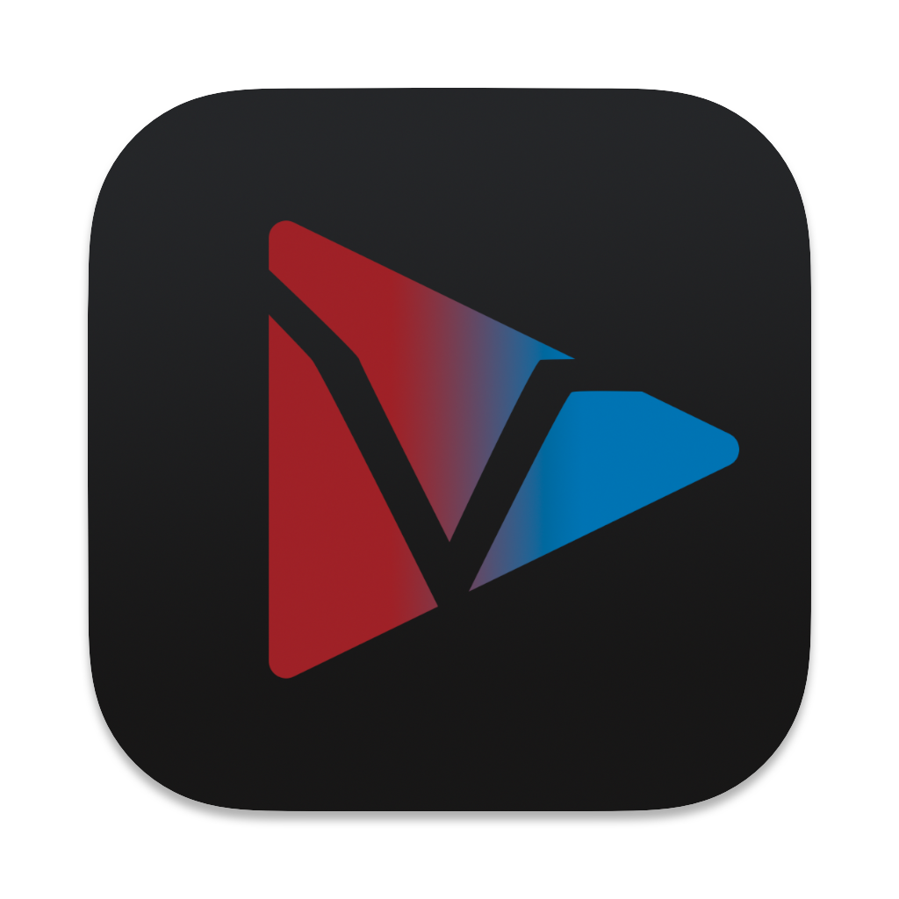

<p align="center">
  
</p>

<h1 align="center">Ultimate VOD Studio</h1>

<p align="center"><i>Easily and quickly cut tournament VODs</i></p>

Ultimate VOD Studio splits tournament VODs and groups them into sets using the stream overlay or ingame tags (for recording setups). It includes an intuitive review screen that lets you quickly fix any errors the broadcaster or the program made. It also includes an upload assistant to easily upload the VODs to YouTube.

Currently supports: SSBU

> **Unofficial fan project.** Not affiliated with or endorsed by any copyright holder of the above games. See [`NOTICE`](NOTICE).

---

## How to Install

| | Download | Run |
|---|---|---|
| **macOS** | [Releases](../../releases) | Unzip → drag to Applications |
| **Windows** | [Releases](../../releases) | Unzip in your target directory → run the `.exe` inside the folder |


**First launch:** 
You'll likely have to approve the "unidentified developer" warnings on the first launch of the app. Afterward, the app will run normally.


- **Windows:** Open the app, you'll get the SmartScreen popup. Click "More info" then "Run anyway".
- **macOS 14 and earlier:** right-click the app, click Open, then Open again.
- **macOS 15 and later:** Open the app normally (or with a right click, it doesn't matter), click "Done", then open the System Settings app and select Privacy & Security, scroll down to "Security", and click "Open Anyway." 


---

## Getting Started

> This program NEVER modifies your original VOD file (it only copies it), so feel free to experiment with this app's options without worrying.

1. Pick a VOD to analyze. Default settings are usually fine.
    - If your tournament has "fancy" fonts, set the font style to "Stylized"
2. If you have an NVIDIA GPU or are on a M1 or later Mac, it should take a couple minutes (or less) to analyze depending on the size of your VOD. If you don't have those, it will still work, but it will take like 10-20 minutes (or more) depending on your machine.
3. Once analysis finishes, you'll be brought to the review screen. Here you can make edits to correct any errors either the program or the streamer made. More often than not, the edits will be minor.
4. Once you're done with your edits, click "Review and export" 


**[For a more in depth guide (with pictures) click here!](USAGE.md)**

---

## Default Clip Export Directories 
You can change these in settings.

- **macOS:** `~/Movies/Ultimate VOD Studio/`
- **Windows:** `Videos\Ultimate VOD Studio\`

---

## Future Plans

- VOD Thumbnail generator
- Support for other games (e.g. Rivals 2 or other fighting games)

---

## For developers

<details>
<summary><b>Run from source</b> (click here) </summary>
Python 3.12+

```bash
git clone https://github.com/Sandfall/ultimate-vod-studio.git
cd ultimate-vod-studio
uv run --extra gui ultimate-vod-studio
```

The model weights aren't in the repo. You have to grab them from the repo before analyzing.

```bash
python src/vodparse/cli/download_weights.py
```

For the stylized text option, you need to do another download.

```bash
python -m vodparse.cli.doctr_support fetch
```

You can optionally run analysis/extraction from the command line.

```bash
python -m vodparse.cli.pipeline --video my_vod.mp4
python -m vodparse.cli.extract_matches --input json_output/my_vod/pipeline.json --video my_vod.mp4
```

The first command finds the matches and writes them to `json_output/`. The second one cuts the video into individual sets. You'll get a bunch of .mp4 files and a .csv with extra data in `video_out/`

This is fully automated (with no corrections), so it's not recommended you run it this way. You can use `vodparse.cli.pipeline` in a loop to batch analyze a bunch of vods if you have a lot. Then you can select the VOD in the GUI and skip past the analysis step.

</details>

<details>
<summary><b>Build the app on your machine</b></summary>

Run `build_mac.sh` (macOS) or `build_windows.ps1` (Windows) from the repo root

</details>

---

## About the models

The character and timer detection models were trained on my own captured footage from my console (as well as synthetic data). No tournament streams were used to train these models. These models were trained on my own laptop (not in the cloud or whatnot). 

---

Built on [YOLOv8](https://github.com/ultralytics/ultralytics) for detection, reading overlay text with [EasyOCR](https://github.com/JaidedAI/EasyOCR) (**Standard**) or [docTR](https://github.com/mindee/doctr) (**Stylized**).

**AGPL-3.0** ([`LICENSE`](LICENSE)) · [`NOTICE`](NOTICE) · Maintained by **Sandfall**.
