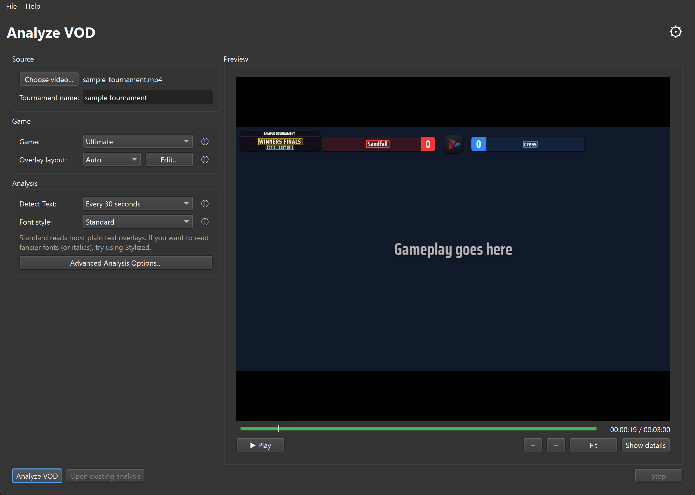
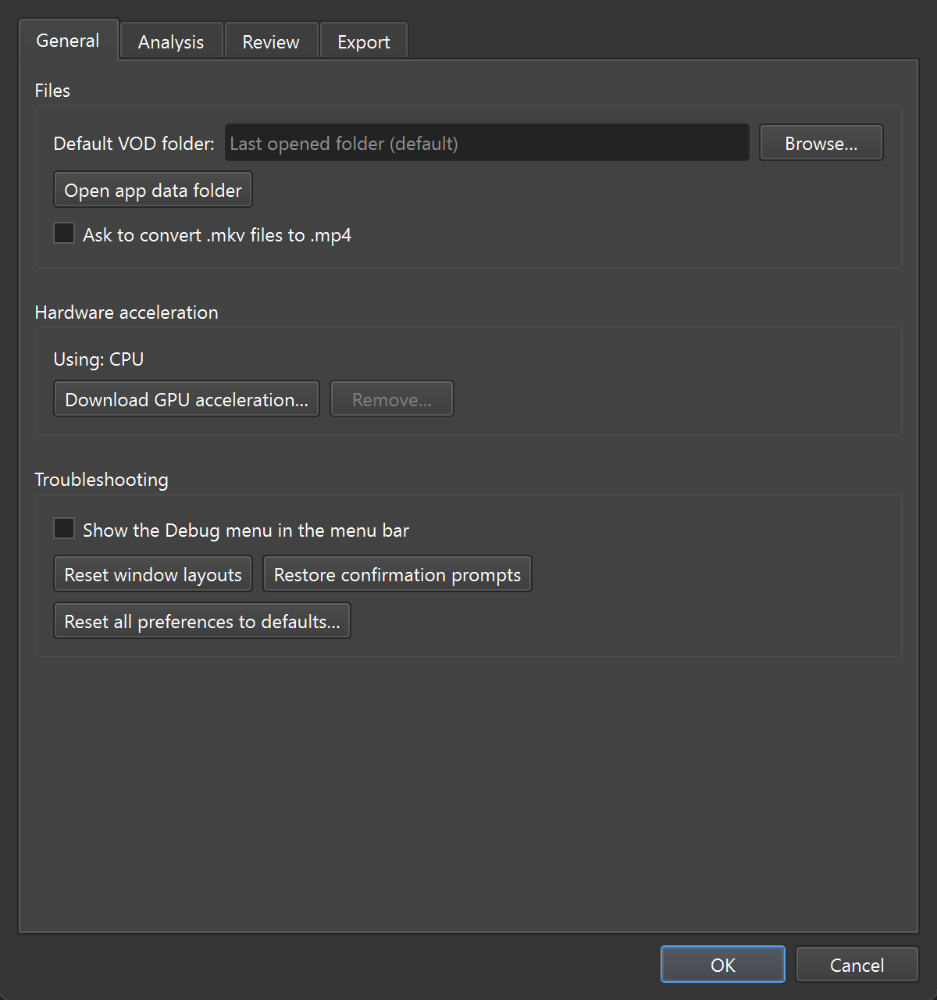
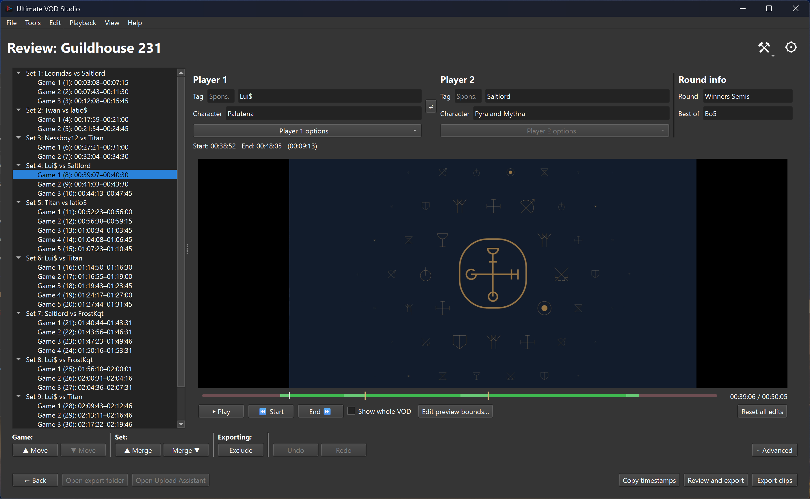
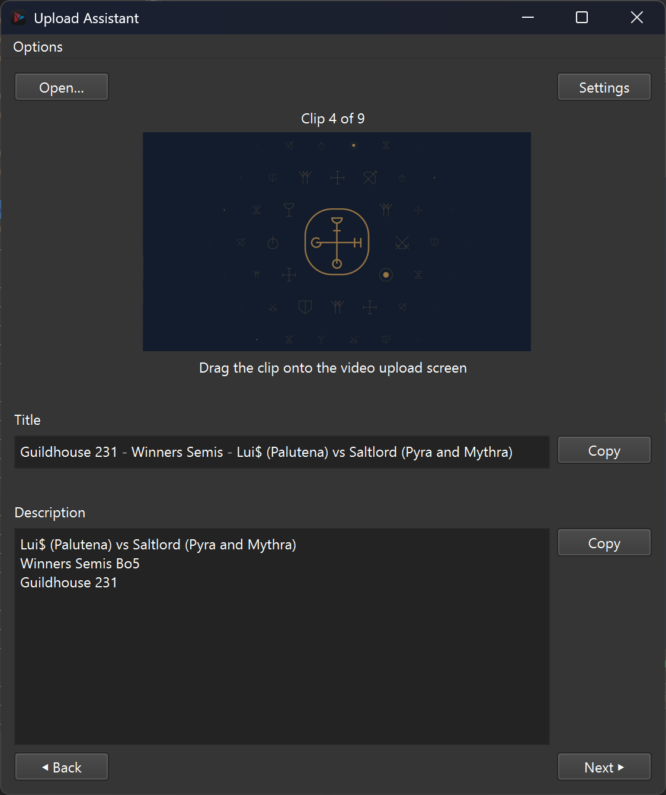
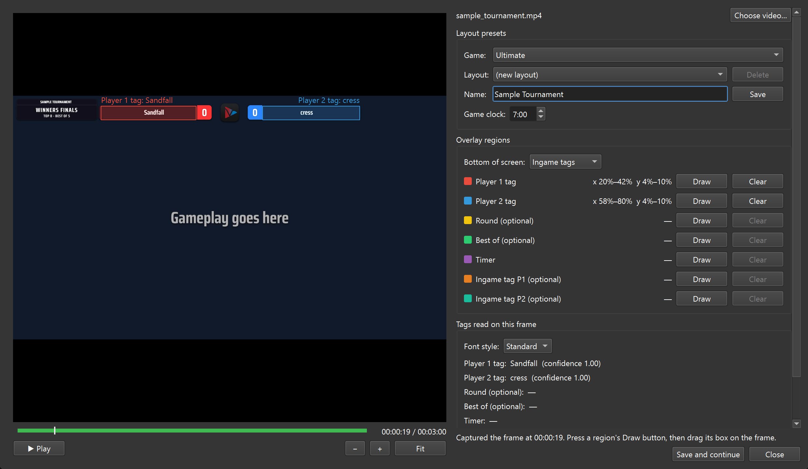

# Usage Guide

> This program NEVER modifies your original VOD file (it just copies it), so feel free to experiment with this app's options without worrying.

## Start

1. Pick your game in the "Game" dropdown menu, then pick a VOD to analyze. I recommend leaving all the other settings at their defaults for the first time using the app.
    1. If your tournament overlay has stylized text (italics, really bold letters, weird fonts, etc.), then select the "Stylized" font option
    2. If you are analyzing an unsupported game or if the preview/analysis keeps missing your stream's player tags, see "custom overlay layouts" below
2. If you have an NVIDIA GPU or are on an M-series mac, it should take a couple minutes (or less) to analyze depending on the size of your VOD. If you don't have those, it will still work, but it will take like 10-20 minutes (or more) depending on your machine.
3. Once analysis finishes, you'll be brought to the review screen. Here you can make edits to correct any errors either the program or the streamer made. If your production is on point, you may not have to change anything.
4. You can quit out of the review screen and resume your draft at any time.

---

## Review screen

1. You'll see a video player where you'll be able to scrub through each set of the vod. Green is the part of the video that will appear in the set when you export it, red is outside the bounds of the set.
    1. you can edit how much "red" you see with the "Edit preview bounds" button.
    2. Light green is still a part of the set, but (usually) doesn't contain any gameplay (CSS, player cam, etc.)
2. There's a sidebar that shows the set and each individual game in each set. Clicking on the set will pull that set up on the video player
    1. Some matches will be highlighted different colors. These are matches that are flagged for you to look a little closer at them. Click on them and it will give you some info about them and sometimes a possible fix. You can turn these highlights on or off in Settings.
3. There's editable text boxes on the top that let you edit the tags for each player, their sponsors/crews, detected characters, round, and other info.
    1. There's options under them to let you do stuff like copy any tag edits to other sets (like if one of your players used a troll tag and you want to change it back to their "normal" one).
    2. There's also a button that will let you swap characters between players easily (when the stream overlay doesn't match the port)

---

## Review options

- Move games between sets
    - use this when the streamer forgets to change the overlay (or changes it too late)
- Merge sets
    - Use this when an overlay changes mid set or the program doesn't correctly group two sets for whatever reason
- Exclude
    - exclude games or entire sets. Use this for friendlies/casuals or handwarmers
- Split sets
    - Split sets that were incorrectly grouped together either by overlay error, program error, or some other reason.
    - split a grand finals set into set 1/2 if you want
- Split game
    - You can split a game in two. This is mainly used if the program combined two games it shouldn't have, or if you want to split off a handwarmer from the beginning that the program included in the game (this can happen at longer analysis intervals)
    - This is a niche option that you probably won't need to use, but it came up a few times in my testing
- Mark Start/end
    - this lets you manually mark the start and end of a set. You can use this to either increase or decrease the size of the set clips on either side
- Undo/redo
    - everything you do on this screen is undoable. You can either use the keyboard shortcut or the button. Feel free to experiment with the buttons to see what they do for yourself. You can always easily undo it.
- Reset all edits
    - resets all your edits. If you're resuming from a draft, you have the option to revert back to that instead.

---

## Tools (button on top right)

- Split sponsor from tag
    - pulls up a window that lets you automatically split sponsors from tags (with some configuration to make it accurate)
- Fix capitalization across all sets
    - pulls up a window that lets you automatically fix capitalization for player tags. This is here since having tags be in all caps is a common style for overlays.
- Change tournament name
    - In case you forgot to do it in the previous step
- Reread tags
    - lets you tweak the tag reading options to (maybe) get better automatic groupings. This doesn't require the vod to be reanalyzed and is pretty quick. The "auto" setting grabs the best combination most of the time though, so unless you have a particularly weird overlay, you probably won't need to use this

---

## Export options

### Export
- exports the clips to a folder, then the program offers to open the folder or the upload assistant after

### Review and export
- Review the sets/characters in a compact view to make sure characters/tags look right before exporting.
- Lets you make some minor edits on this screen (character swaps and such)

### Copy timestamps
- Don't want to upload each individual vod? You can just get the timestamps here

---

## Upload assistant

- A popup that floats above all other windows and lets you easily upload the clips to youtube
- Drag the clip to the upload screen just like you would a file to upload a video
- Press the copy button to copy the title to your clipboard and paste the title into the uploader
- You can configure the generated titles in the upload assistant settings
- The thumbnail it shows for each clip is taken a few seconds after the clip's first game starts (so it isn't the player cams). You can change the delay in the upload assistant settings

---

## Custom overlay layouts

If the VOD analysis keeps misreading tags or you want to analyze a game that isn't supported, you have the option to create your own custom overlay layout.

1. On the main screen (before analyzing), go to the Overlay layout row and click "Edit..."
2. Load a VOD (if you haven't done so on the previous screen) and move the video playhead to a frame where the overlay is on screen.
3. Click the Draw button next to the fields you want to draw/analyze
    1. Draw the box around the whole name (including the sponsor)
    2. You can resize the boxes by dragging corners and move them around by clicking and dragging the middle
    3. Player 1 and 2 tags are required. If you have "Other" selected as your game, the timer is also required
4. "Tags read on this frame" lets you preview the tag/round/etc. reading. If a tag comes out wrong, try to adjust it (or swap from Standard to Stylized font).
5. Give the layout a name and click "Save and continue". You can use it again from the Overlay layout dropdown menu.

---

## Troubleshooting

- If a video loads but the picture doesn't show, you can convert it to a .mp4 file using "File → Convert to MP4…"
    - On Windows, if you prefer to have it ask to convert .mkv to .mp4 before analysis, you can toggle that in the settings. On a Mac, it will always ask to convert since macOS currently doesn't support playing .mkv files with its native video player.
